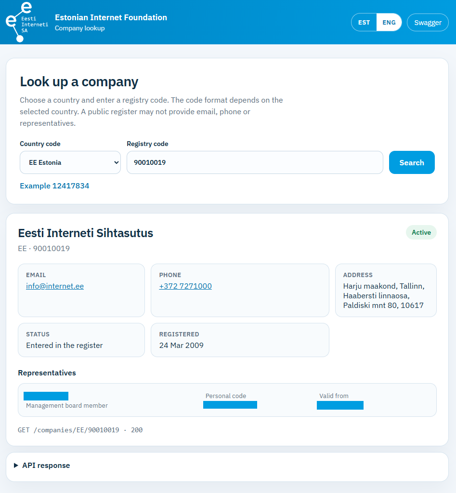
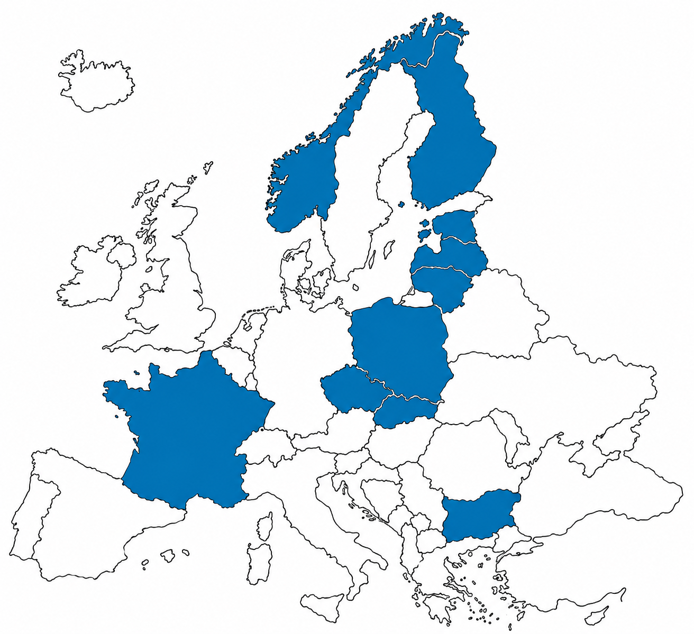

# Company lookup

A Ruby application that takes a country code and a registry code and returns the company name, contacts, address, registration, status, and representatives. The data comes from the public registers of Bulgaria, Czechia, Estonia, Finland, France, Latvia, Lithuania, Norway, Poland and Slovakia. This API has no key of its own.

The application listens at `http://127.0.0.1:4567`.

## Requirements

- Ruby 3.2
- Node.js, because the Swagger UI files come from the `swagger-ui-dist` package
- An internet connection. Each search reads the data directly from that country's register

## Run it locally

From the project folder:

```powershell
bundle config set --local path vendor/bundle
bundle install
npm install
bundle exec rackup -s webrick -p 4567 -o 127.0.0.1 config.ru
```

The server keeps running until the window is closed. After a code change, start it again.

Webrick is used here because Puma does not compile on Windows.

## How to connect

The only data request is:

```http
GET /companies/{country_code}/{registry_code}
```

Example:

```text
http://127.0.0.1:4567/companies/EE/12417834
```

The country code may be upper or lower case. The response is JSON, encoded as UTF-8. There is no authentication.

Other addresses:

| Address | What it is |
| --- | --- |
| `http://127.0.0.1:4567/` | Search form |
| `http://127.0.0.1:4567/docs/` | Swagger UI |
| `http://127.0.0.1:4567/openapi.yaml` | OpenAPI description |

The form calls the API on the same host. A static page alone, such as GitHub Pages, cannot complete a search, because the Ruby application has to be running at the same time.

## Testing

<div>
  <p align="center">
    
  </p>
</div>

### Web form

1. Open `http://127.0.0.1:4567/`.
2. Choose a country. Below the field there is one sample button, and it shows only that country's code.
3. Press the sample, or type a code yourself, and press **Search**.
4. The card shows the name, contacts, address, status, dates, and representatives. Below it is the same JSON the API returned.
5. **EST** and **ENG** switch the page language. The API JSON stays in English. The page translates known status names, roles and error messages.
6. The language can also be set in the address: `?lang=et` or `?lang=en`.

Samples:

| Country | Code | Company |
| --- | --- | --- |
| BG | `130007884` | "БИЛЛА БЪЛГАРИЯ" ЕООД |
| CZ | `00177041` | Škoda Auto a.s. |
| EE | `12417834` | Bolt Technology OÜ |
| FI | `0112038-9` | Nokia Oyj |
| FR | `552081317` | ELECTRICITE DE FRANCE (EDF) |
| LT | `121215434` | Telia Lietuva, AB |
| LV | `40003032949` | Akciju sabiedrība "Latvenergo" |
| NO | `923609016` | EQUINOR ASA |
| PL | `0000006865` | CD PROJEKT RED SPÓŁKA AKCYJNA |
| SK | `35763469` | Slovak Telekom, a.s. |

### Swagger

1. Start the server and make sure `npm install` has been run. Without it, the `/docs/` styles and scripts are missing.
2. Open `http://127.0.0.1:4567/docs/`.
3. Open `GET /companies/{country_code}/{registry_code}`.
4. Press **Try it out**, fill in `country_code` and `registry_code`, then press **Execute**.
5. The response is the same JSON as in Postman and on the web form.

### Postman

1. Create a request with method **GET**.
2. Address: `http://127.0.0.1:4567/companies/EE/12417834`.
3. No headers or body are needed.
4. Press **Send**.

The OpenAPI file can also be imported into Postman: **Import**, then the file `openapi.yaml`, or the address `http://127.0.0.1:4567/openapi.yaml` while the server is running.

In PowerShell, `curl` is a different command. Use `curl.exe`:

```powershell
curl.exe http://127.0.0.1:4567/companies/FI/0112038-9
```

## Supported countries

The menu lists the codes in alphabetical order: BG, CZ, EE, FI, FR, LT, LV, NO, PL, SK. Any other country code returns `422`.

| Code | Country | Registry code | Example |
| --- | --- | --- | --- |
| BG | Bulgaria | 9 digits | `130007884` |
| CZ | Czechia | 8 digits, including leading zeros | `00177041` |
| EE | Estonia | 8 digits | `12417834` |
| FI | Finland | 7 digits, a hyphen, and a check digit. `01120389` without the hyphen is also accepted | `0112038-9` |
| FR | France | 9 digits | `552081317` |
| LT | Lithuania | 9 digits | `121215434` |
| LV | Latvia | 11 digits | `40003032949` |
| NO | Norway | 9 digits | `923609016` |
| PL | Poland | 10 digits, including leading zeros | `0000006865` |
| SK | Slovakia | 8 digits | `35763469` |

A code in the wrong shape returns `400`. A code in the right shape that the register does not contain returns `404`.

## Response

A successful response always has the same shape. A missing value is `null`. When there are no representatives, `representatives` is an empty array.

```json
{
  "country_code": "EE",
  "registry_code": "12417834",
  "name": "Bolt Technology OÜ",
  "email": "registry.notices@bolt.eu",
  "phone": "+372 56645297",
  "address": "Harju maakond, Tallinn, Kesklinna linnaosa, Vana-Lõuna tn 15, 10134",
  "registered_on": "2013-02-07",
  "deleted_on": null,
  "active": true,
  "status": { "code": "R", "name": "Entered in the register" },
  "representatives": [
    {
      "name": "Markus Villig",
      "personal_code": "39312170011",
      "role": "Management board member",
      "valid_from": "2013-02-07"
    }
  ]
}
```

- `registered_on` is the date the company was entered in the register, in the form `YYYY-MM-DD`.
- `deleted_on` is filled when the company has been deleted, has ceased, or has been reorganised. For an active company it is `null`.
- `active` is `true` only when the company is entered in the register in the ordinary way. Liquidation, bankruptcy, and deletion are `false`.
- `status.name` and `representatives.role` are in English. `status.code` is the country's own code.
- `phone` joins the landline and the mobile number with a comma when both exist.
- `representatives` contains the current representatives. Ended roles are not returned.

<div>
  <p align="center">
    
  </p>
</div>

### Bulgaria

The source is the Registry Agency commercial register: [portal.registryagency.bg](https://portal.registryagency.bg/CR/api/Deeds/130007884). No key is required. The registry code is the 9-digit UIC (EIK). A branch number has 13 digits and is not accepted here. The site certificate chains to Sectigo Public Server Authentication Root R46, which is kept next to the lookup code because that root is not in Ruby's default certificate bundle.

The response includes the name, registered office, the date of the electronic register entry, status, managers, the sole owner when one is registered, and a procurator while that role is current. Email and phone stay empty. Personal identity numbers are not published, so `personal_code` stays empty.

`active` is `false` when the company is deleted, in liquidation, or in insolvency. A company that existed before the central electronic register can show the date it was copied into that register, rather than the original court-file year.

| Code | Name |
| --- | --- |
| R | Entered in the register |
| L | In liquidation |
| N | In bankruptcy |
| K | Deleted |

### Czechia

The source is the Ministry of Finance economic-entity register ARES: [ares.gov.cz](https://ares.gov.cz/ekonomicke-subjekty-v-be/rest/ekonomicke-subjekty/00177041). No key is required. The registry code is the 8-digit IČO, including leading zeros. The public register view supplies the current directors, supervisory board, procurators, and the shareholder or stockholder when the commercial register publishes them.

The response includes the name, registered office, establishment date, status, and those current people. Email and phone stay empty. Birth dates are not copied into `personal_code`. Ended roles are left out. A subject that is not in the commercial register still returns the ARES summary, with an empty representative list.

`active` is `false` when the subject has a dissolution date, is recorded as dissolved, is in liquidation, or is in the insolvency register. The dissolution date is `deleted_on`.

| Code | Name |
| --- | --- |
| R | Entered in the register |
| L | In liquidation |
| N | In bankruptcy |
| K | Deleted |

### Estonia

The source is the public business-register search and the company card at [ariregister.rik.ee](https://ariregister.rik.ee/). The contracted REST API is not used.

The response includes the name, email, phone, address, registration date, deletion date, and every current representative, with personal code, role, and the date the role started.

`active` is `true` only for status `R`.

| Code | Name |
| --- | --- |
| R | Entered in the register |
| L | In liquidation |
| N | In bankruptcy |
| K | Deleted |

A deleted company has `deleted_on` filled. The card is read from HTML, so a change to the register page can leave email, phone, or representatives empty, while the name and address still come from the JSON search.

### Finland

The source is PRH open data: [avoindata.prh.fi](https://avoindata.prh.fi/opendata-ytj-api/v3/companies). The paid service at [tietopalvelu.ytj.fi](https://tietopalvelu.ytj.fi/) is not used.

The response includes the name, address, registration date, and status. Email, phone, and representatives stay empty, because the open data does not contain them. This interface does not cover private traders (`toiminimi`).

`active` is `true` when the company is in the trade register and the business ID is valid. When the activity has ceased or the company has been removed from the register, `active` is `false` and `deleted_on` is the end date, if the register provides one.

| Code | Name |
| --- | --- |
| 0 | Unregistered |
| 1 | Entered in the register |
| 2 | Removed from the register |
| 3 | Unregistered start-up |
| 4 | Ceased |
| 5 | Business ID invalidated |

### France

The source is the French government company search: [recherche-entreprises.api.gouv.fr](https://recherche-entreprises.api.gouv.fr/search?q=552081317). No key is required. The registry code is the SIREN number.

The response includes the name, head-office address, registration date, status and the representatives the register publishes. Email and phone stay empty. Personal identity numbers are not published, so `personal_code` stays empty. A company the register marks as non-diffusible is not returned.

`active` is `false` when the company is closed. A closed company has `deleted_on` filled when the register publishes a closure date.

| Code | Name |
| --- | --- |
| R | Entered in the register |
| K | Deleted |

### Lithuania

The source is the Centre of Registers open data at [get.data.gov.lt](https://get.data.gov.lt/datasets/gov/rc/jar/iregistruoti/JuridinisAsmuo). When that service returns an error, the same register is read from the public copy at [jar.lapas.info](https://jar.lapas.info/).

The response includes the name, address, registration date, and status. Email, phone, and representatives stay empty. A deleted company has `deleted_on` filled and `active` is `false`.

An ordinary registered company gets the code `R`. Other situations use `LT` plus a number. For example, `LT7` is in liquidation and `LT10` is removed from the register. The name is in `status.name`.

### Latvia

The source is the Register of Enterprises open data at [data.gov.lv](https://data.gov.lv/dati/eng/dataset/uz).

The response includes the name, address, registration date, status, and current representatives. Email and phone stay empty. The personal code is in the form the register publishes, often partly hidden, for example `280476-*****`.

| Code | Name |
| --- | --- |
| R | Entered in the register |
| K | Deleted |
| REORG | Reorganised |

A deleted or reorganised company has `deleted_on` filled and `active` is `false`.

### Norway

The source is the Brønnøysund Register Centre open data: [data.brreg.no](https://data.brreg.no/enhetsregisteret/api/enheter/923609016). No key is required. The registry code is the organisation number.

The response includes the name, address, phone when the register publishes one, registration date, status and current representatives. Email stays empty when the register does not publish it. Personal identity numbers are not published, so `personal_code` stays empty. Ended roles are left out. A deputy board member is included while that role is current.

`active` is `false` when the entity has been removed, is bankrupt, or is in liquidation. A removed entity has `deleted_on` filled.

| Code | Name |
| --- | --- |
| R | Entered in the register |
| L | In liquidation |
| N | In bankruptcy |
| K | Deleted |

### Poland

The source is the Ministry of Justice open API for the National Court Register: [api-krs.ms.gov.pl](https://api-krs.ms.gov.pl/api/krs/OdpisAktualny/0000006865?rejestr=P&format=json). No key is required. The registry code is the KRS number.

The lookup reads the entrepreneurs' register first. If that number is not there, it reads the register of associations and other organisations. A company removed from the register has no current extract, so the full extract is used instead.

The response includes the name, address, registration date, status and current representatives. Email is filled when the register publishes one. Phone stays empty, because this open data does not contain it. Personal names and identity numbers are partly hidden, in the form the register publishes, for example `P**** M***** N**********`.

`active` is `true` for an ordinary registered company and for a company under restructuring. Liquidation, bankruptcy and removal from the register are `false`. A removed company has `deleted_on` filled.

| Code | Name |
| --- | --- |
| R | Entered in the register |
| L | In liquidation |
| N | In bankruptcy |
| K | Deleted |
| RS | Under restructuring |

### Slovakia

The source is the Ministry of Justice commercial register: [sluzby.orsr.sk](https://sluzby.orsr.sk/api/legal-person?Filter.CorporateBodyFullNameOrRegistrationNumber=35763469). No key is required. The registry code is the 8-digit IČO. The search finds the court file, and a second call reads the current extract.

The response includes the name, registered office, establishment date, status, and the current management board, supervisory board, managing directors, procurators, and the shareholder or stockholder when the extract publishes them. Email and phone stay empty. Personal identity numbers are not copied into `personal_code`. Ended roles, predecessors, and participating companies are left out.

`active` is `false` when the company has been deleted, is in liquidation, or is in bankruptcy or composition proceedings. Restructuring stays `active`. The termination date is `deleted_on`.

| Code | Name |
| --- | --- |
| R | Entered in the register |
| L | In liquidation |
| N | In bankruptcy |
| K | Deleted |
| RS | Under restructuring |

## Countries that need extra access

These countries were checked and are not in the menu. A request with one of these country codes returns `422`. The notes below say where the data lives and what has to be arranged before a lookup can be added.

### Austria

The commercial register is the Firmenbuch, published on [justizonline.gv.at](https://justizonline.gv.at/jop/web/firmenbuchabfrage). The public search is a website, not a JSON API.

The official machine interface is free, and it is SOAP XML. Access needs an ID Austria login, an approved information-reuse application, and an API key sent in the `X-API-KEY` header. A call without that key returns `401`. The application is made at [justizonline.gv.at/jop/web/iwg](https://justizonline.gv.at/jop/web/iwg). Questions go to `justizonline-iwg@brz.gv.at`. The service description is the [WebService-HVD package](https://justizonline.gv.at/jop/web/assets/iwg/WebService-HVD.zip). The WSDL is `https://justizonline.gv.at/jop/api/at.gv.justiz.fbw/ws/fbw.wsdl`.

The dataset covers the name, status, registration number, legal form, registered office, activities, accounts and authorised officers. The company identifier is the Firmenbuch number: digits plus a check letter, for example `93363z`. A certified extract is a separate paid document.

### Belgium

The register is the Crossroads Bank for Enterprises (KBO/BCE).

The official lookup is a free SOAP XML web service. Each call needs a username and a password hash. An account is created at [kbopub.economie.fgov.be/kbo-open-data/login](https://kbopub.economie.fgov.be/kbo-open-data/login), and the terms of use have to be accepted. After that, the limit is 3,000 requests a day. A call without an account does not return company data. Questions go to `kbo-bce-webservice@economie.fgov.be`. The WSDL is `https://kbopub.economie.fgov.be/kbopubws180000/services/wsKBOPub?wsdl`.

The enterprise number is 10 digits, for example `0314595348`. The public search at [kbopub.economie.fgov.be](https://kbopub.economie.fgov.be/kbopub/zoeknummerform.html) is an HTML form.

### Croatia

The register is the court registry, published as JSON at [sudreg-data.gov.hr](https://sudreg-data.gov.hr/api/javni/dokumentacija/open_api).

Access needs a free public-user registration. The token is requested with OAuth2 client credentials from `https://sudreg-data.gov.hr/api/oauth/token` and lasts 6 hours. The client id and the client secret both end with two dots, and those dots are part of the value. A call without a token returns `401`. One company is then read with `GET https://sudreg-data.gov.hr/api/javni/detalji_subjekta?tip_identifikatora=oib&identifikator={oib}`. The same method accepts the 9-digit court number when `tip_identifikatora` is `mbs`. That method allows 6 requests a minute. Questions go to `sudski.registar@pravosudje.hr`.

The public response includes the name, address, email, legal form, founding date, deletion date and status. It does not include a phone number or representatives, and it has no history. The data is refreshed once each working day. The OIB is 11 digits.

### Cyprus

There is no keyless JSON lookup. The public search is an HTML form at [efiling.drcor.mcit.gov.cy](https://efiling.drcor.mcit.gov.cy/DrcorPublic/SearchForm.aspx?sc=0). It accepts a numeric registration number or a name.

The free view shows the name, registration date, type, status, address, and the current directors and secretary. The full electronic file needs a CY Login and costs €10. It is ordered at [eforms.eservices.cyprus.gov.cy](https://eforms.eservices.cyprus.gov.cy/MCIT/RCOR/OrganisationFileSearch).

The official machine-readable source is a monthly CSV dump, last modified on 31 July 2026, under CC BY 4.0: [data.gov.cy dataset 1026](https://data.gov.cy/en/dataset/1026). The three files are `organisations_102.csv`, `registered_office_101.csv` and `organisation_officials_88.csv`. They do not contain email or phone. A registration number is not unique unless the organisation type is known. Overseas companies use type `O`. The portal API serves catalogue metadata, not one company.

### Denmark

The register is the Central Business Register (CVR), kept by the Danish Business Authority.

The company lookup API is an Elasticsearch service at `http://distribution.virk.dk/cvr-permanent/virksomhed/_search`. Every call needs HTTP Basic authentication. A call without a username and password returns `401`.

Access is free and is requested by email to `cvrselvbetjening@erst.dk`. The message should name the organisation, a contact person, and whether beneficial-owner data is needed. The authority says processing can take up to three weeks. The registry code is the CVR number, 8 digits.

A second official route is the Datafordeler GraphQL service at `https://graphql.datafordeler.dk/CVR/`. It also refuses anonymous calls. A user and an API key are created in Datafordeler Administration. Company records are available with that key. Personal records in the `CVRPerson` entity need a separate approval, MitID Erhverv, OAuth, and an IP allowlist.

The public website `datacvr.virk.dk` answers automated requests with a bot challenge, so it is not a source for this API.

### Germany

The commercial register can be read free of charge on [handelsregister.de](https://www.handelsregister.de/) and [unternehmensregister.de](https://www.unternehmensregister.de/). Both are websites. There is no official JSON API and no credential that opens one.

The terms of use allow at most 60 retrievals an hour. A company has no single national number. The identifier is the register court, the register type (`HRA`, `HRB`, `GnR`, `GsR`, `PR` or `VR`) and the register number.

The company base register at the Federal Statistical Office is closed. Only legally authorised public bodies can use it.

### Greece

The register is GEMI Open Data. Company detail is `GET https://opendata-api.businessportal.gr/api/opendata/v1/companies/{arGemi}`. A call without a key returns `401` and `No API key found in request`.

An account is requested at [opendata.businessportal.gr/register](https://opendata.businessportal.gr/register/). The key is issued after Central GEMI approves the account, and it is sent in the `api_key` header. The published test key does not replace that approval. Questions go to `support@uhc.gr`. The specification is [opendata-api.businessportal.gr/api-docs](https://opendata-api.businessportal.gr/api-docs).

The path uses the 12-digit GEMI number. The 9-digit AFM is a search criterion, not the detail path. A 12-digit number does not fit the current 11-character field. The response includes the Greek name, address, email, legal form, status, incorporation date, and persons with their role and dates. It does not include a company phone or a personal identity number. The licence is ODC-BY 1.0.

### Hungary

The company-information service is XML, not JSON: `https://occsz.e-cegjegyzek.hu/IMOnline`. A call without credentials returns `401`. Access needs a contract with the Ministry of Justice, for one user or for a distributor, arranged through [ceginformaciosszolgalat.kormany.hu](https://ceginformaciosszolgalat.kormany.hu/ceginformacio). Each call then uses HTTP Basic authentication.

Queries are billed. A price quote is requested before the paid query. An insufficient prepaid balance is an error. The developer handbook, dated 20 January 2026, is [XmlUtmutatoPeldak.pdf](https://occsz.e-cegjegyzek.hu/Utmutatok/XmlUtmutatoPeldak.pdf).

The company number is 10 digits, often written `01-09-123456`. With the hyphens that is 12 characters, so it does not fit the current 11-character field. Search can also use the 8-digit stem of the tax number. The name card contains the name, seat, statistical number, tax number and bank account. The free website [e-cegjegyzek.hu](https://www.e-cegjegyzek.hu/) shows a captcha, so it is not a source for this API.

### Ireland

The register is the Companies Registration Office. Company detail is `GET https://services.cro.ie/cws/company/{number}/c?format=json`. A call without credentials returns `401`. The path letter `c` means a company and `b` means a business name. The documentation example is `83740`.

Free Open Services access needs a signup. The signed terms are emailed to `itcro@enterprise.gov.ie`. The services home also lists `crosupportservices@cro.ie`. Each call then sends `Authorization: Basic` with the email address and the API key. The key published on the examples page answers only three sample queries, so it cannot be used here.

The free fields are the name, address lines, registration date, status, status date, annual-return dates and company type. Email, phone and directors are not included. Document images are paid and need a customer account with credit. The terms forbid scanning the register by incrementing numbers.

A daily CSV archive, not a one-company lookup, is published at [opendata.cro.ie/dataset/companies](https://opendata.cro.ie/dataset/companies) under CC BY 4.0. The contact is `registrar@cro.ie`.

### Italy

The public search on [registroimprese.it](https://www.registroimprese.it/) is a website, not a JSON API. The free page shows the name, address, activity, VAT number, REA number, PEC address and status. It does not show representatives.

The official API is the paid InfoCamere service at [accessoallebanchedati.registroimprese.it/abdo/api](https://accessoallebanchedati.registroimprese.it/abdo/api). It needs SPID, CIE or CNS, plus a prepaid Telemaco balance. A full extract is a separate paid document.

VIES, `https://ec.europa.eu/taxation_customs/vies/rest-api/ms/IT/vat/{partitaIVA}`, returns only the name and address for a valid number. `00488410010` is TIM. The code is 11 digits.

### Luxembourg

There is no keyless JSON lookup. The public search is [lbr.lu](https://www.lbr.lu/). The free file view shows the name, RCS number, head-office address, registration date, legal form and branches.

The [terms of use](https://lbrcontent.public.lu/en/informations/conditions-generales.html) require a captcha and limit consultation to manual individual use. Automated reading is prohibited. A certified extract is paid.

An API is considered only after a reasoned written request that states the reuse purpose, and it may require a separate agreement under Article 22(2) of the Grand-Ducal Regulation of 23 January 2003. The contact is `helpdesk@lbr.lu`, telephone `+352 26 428-1`.

The RCS number is a section letter plus digits. Commercial companies are section B. Sections A to O exist, so the number does not fit a digits-only field. Reading public documents in the browser, anonymously or with LuxTrust or eID, is free, and it is still the website.

### Malta

There is no keyless JSON lookup. Company search in BAROS has required a login since 1 August 2025. Registration is free with a Malta Government CORP account, a Malta e-ID, eIDAS, or a non-EU login. The notice is [Public notice: update to access to basic information on the BAROS](https://www.mbr.mt/post/public-notice-update-to-access-to-basic-information-on-the-baros).

The machine API is for AML subject persons, such as banks and corporate service providers. It has no public address and no public key. Questions go to `ictsupport.mbr@mbr.mt`. The packages are described in [MBR's launch of the API packages for subject persons](https://www.mbr.mt/post/mbr-s-launch-of-the-api-packages-for-subject-persons). Search by name or number returns the name, number, registration date and state. Basic details add the address. Full details add involvements, share capital and the filing list.

A company number starts with `C` and then digits, so it does not fit a digits-only field.

### Netherlands

The usable lookup is the paid KVK Basisprofiel. A call without a key returns `401`.

Anyone may apply only when they are registered in the Dutch Business Register and authorised to sign. Private use is excluded. The application is made at [developers.kvk.nl](https://developers.kvk.nl/). The connection costs €6.40 a month for each API key. The key is sent in the `apikey` header. Search costs nothing per query. Basisprofiel, Vestigingsprofiel and Naamgeving cost €0.02 per query. The limits are 300,000 queries a month and 100 queries a second. The ordering page is [Get business data with KVK APIs](https://www.kvk.nl/en/ordering-products/get-business-data-with-kvk-apis/).

One company is `GET https://api.kvk.nl/api/v1/basisprofielen/{kvkNummer}`. The KVK number is 8 digits. The response includes the name, trade names, registration date, activities, head-office address and websites. It does not include email, phone or a list of representatives. The published test key and the test host answer fictitious companies only, so they cannot be used here. A branch number is 12 digits and would not fit the current field.

The open dataset needs no subscription: `GET https://opendata.kvk.nl/api/v1/hvds/basisbedrijfsgegevens/kvknummer/{kvkNummer}`. It covers only BV and NV companies, under CC BY 4.0. It deliberately omits the company name, the KVK number and the street address. It returns the start date, whether the company is active, an insolvency code, the legal form, the first two digits of the postcode, and the activities. One address may send 1 request a minute, and all users share a limit of 200 requests in 5 minutes.

### Portugal

Published company acts can be searched free of charge on [publicacoes.mj.pt](https://publicacoes.mj.pt/pesquisa.aspx). The page is an HTML form. It lists published acts, and the search has required a captcha. It does not return a company profile.

The company electronic card is free to open once its access code is known. The code is issued with the card. The permanent certificate is a separate paid document from the Institute of Registries and Notaries.

The only keyless machine-readable source is the EU VAT check, VIES: `https://ec.europa.eu/taxation_customs/vies/rest-api/ms/PT/vat/{nipc}`. For a valid NIPC it returns the name and address. It does not return a registration date, status, representatives, email or phone. The NIPC is 9 digits. `500697256` is EDP, S.A.

### Romania

The trade register is ONRC. It has no keyless JSON lookup for one company.

The open data is a monthly CSV snapshot on [data.gov.ro](https://data.gov.ro/organization/onrc), under CC BY 4.0. The latest snapshot is dated 19 October 2026. The companies file is about 696 MB and the legal-representatives file is about 337 MB. Together they contain the name, CUI, registration number, address, legal form, registration date, status and representatives. They do not contain email or phone. This is a copy of the whole register, not a lookup.

The live view is [portal.onrc.ro](https://portal.onrc.ro/). It needs an account. The free view shows the name, registration number, CUI, county, locality, status and the date of the latest entry. Since Law 265/2022 it also shows the legal representatives, branches opened in another EU country, and the website when one is registered. The detailed RECOM service needs a contract and a prepaid balance of at least 300 RON. A historical report costs 250 lei per company, and a criterion-based extract costs 9 lei per company. The contact is `onrc@onrc.ro`.

The tax authority has a separate keyless JSON service, `POST https://webservicesp.anaf.ro/api/PlatitorTvaRest/v9/tva`, with one request a second. For CUI `5022670` it returns BANCA TRANSILVANIA SA, the address, phone, registration date, legal form and trade-register number. It does not return email or representatives, and the status is the tax registration. A CUI has up to 10 digits. The trade-register number starts with a letter, for example `J1993004155124`, so it does not fit a digits-only field.

### Slovenia

The register is the Slovenian Business Register (PRS), kept by AJPES.

The lookup API is `https://www.ajpes.si/restPrsInfo`. Swagger is published at `https://www.ajpes.si/restPrsInfo/swagger/index.html`. Each call needs three values from AJPES: the portal username, the password, and the code of a data schema registered for that user. The data packages behind a schema are paid. A test password is sent by email from `cpu.it@ajpes.si`. The registry code is the `matična številka`, 10 digits.

A free file is published on [podatki.gov.si](https://podatki.gov.si/dataset/poslovni-register-slovenije) and refreshed twice a month. It contains the registration number, name, address, legal form and registering authority. It does not contain email, phone, status or representatives.

The ePRS website requires a free AJPES account and is a manual search.

### Spain

The free company directory is [opendata.registradores.org](https://opendata.registradores.org/). It is a website. A picture puzzle is shown before a search, and automated requests are blocked. There is no JSON lookup.

The official gazette API is keyless. `GET https://www.boe.es/datosabiertos/api/borme/sumario/{YYYYMMDD}` returns one day's BORME summary as JSON. The technical description is the [BORME summary API](https://www.boe.es/datosabiertos/documentos/APIsumarioBORME.pdf). The summary is a list of published acts for that date, not a company looked up by NIF.

A full extract is ordered on [sede.registradores.org](https://sede.registradores.org/site/mercantil). An occasional user needs a digital certificate, and the extract is paid. The company identifier is the NIF: one letter and 8 digits, for example `A28015865`.

### Sweden

The register is Bolagsverket. The free dataset API is called Värdefulla datamängder.

A client id and a client secret are created once in the [Bolagsverket API portal](https://portal.api.bolagsverket.se/). The token endpoint is `https://portal.api.bolagsverket.se/oauth2/token`. Company data is then requested with that bearer token from `https://gw.api.bolagsverket.se/vardefulla-datamangder/v1`, with `POST /organisationer`. A call without the token returns `401` and `Missing Credentials`.

The organisation number is 10 digits, often written `NNNNNN-NNNN`. The public website sits behind a bot wall, so it is not a source for this API. The client secret belongs in a local settings file.

## Error responses

| Code | Meaning | Example |
| --- | --- | --- |
| 200 | Company found | |
| 400 | The registry code does not match the country's format | `{"error":"The registry code must be an 8-digit number"}` |
| 404 | Company not found | `{"error":"Company not found","country_code":"EE","registry_code":"00000000"}` |
| 422 | The country is not supported | `{"error":"Only Bulgarian, Czech, Estonian, Finnish, French, Latvian, Lithuanian, Norwegian, Polish and Slovak companies are supported","country_code":"SE"}` |
| 502 | The register request failed | `{"error":"The business register request failed"}` |

An unknown address that is not a company request returns `404` and `{"error":"Address not found"}`.

`502` means the external register did not respond. The code may still be valid. For Lithuania, the application tries the public copy before returning that response.
